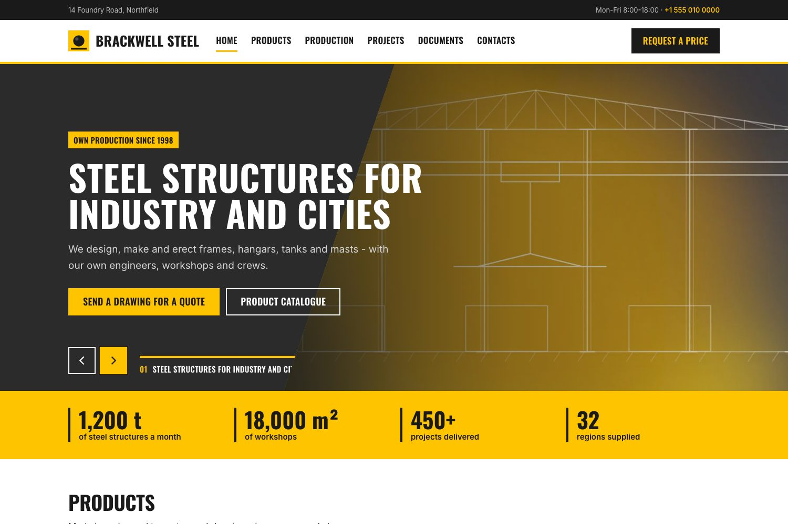
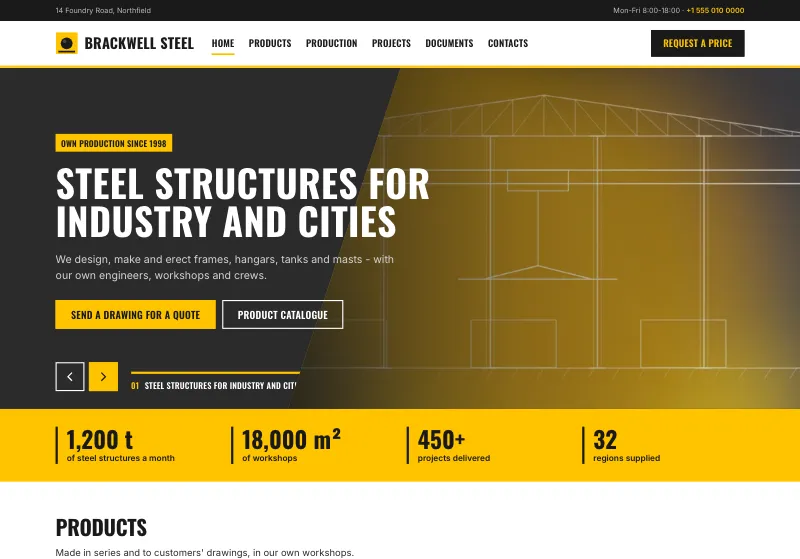
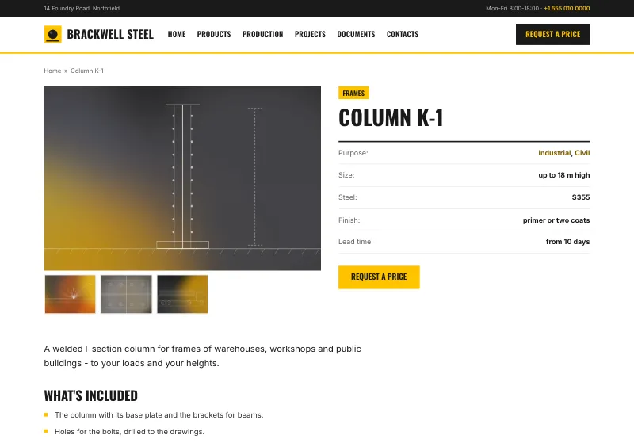
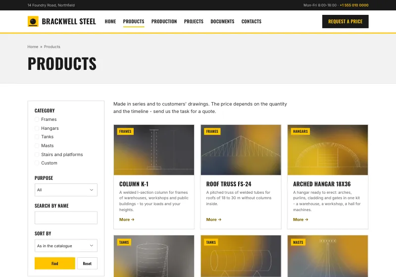
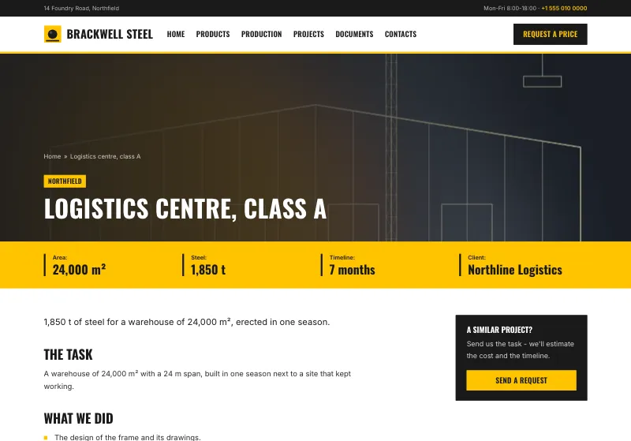
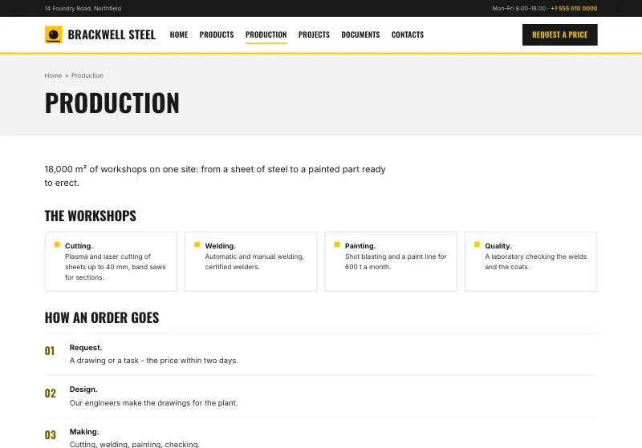
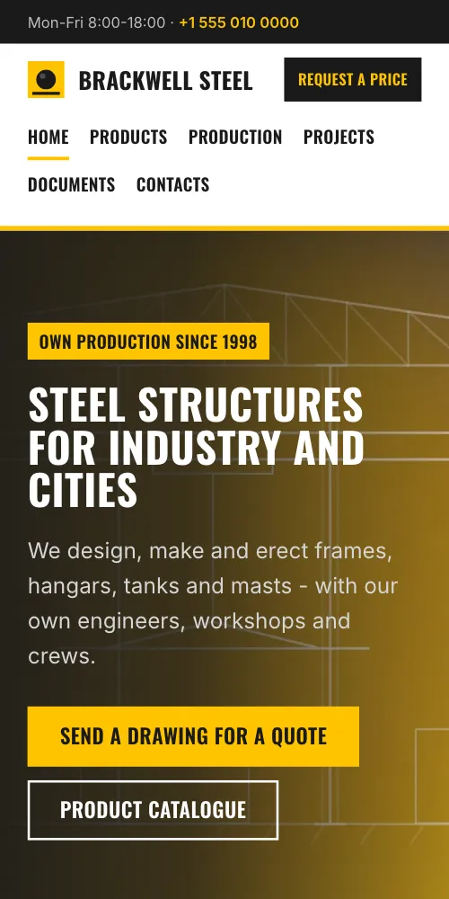
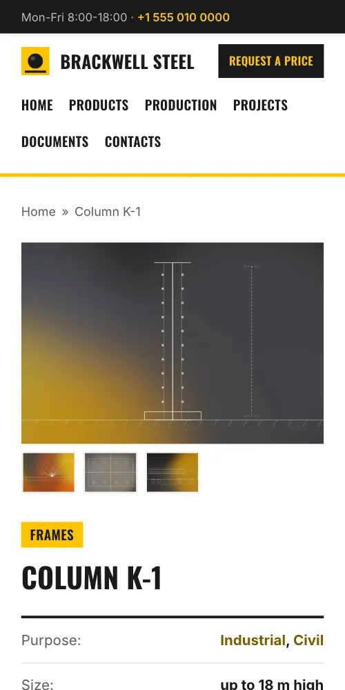

# Rivet

A theme for [Kosatka](https://github.com/kosatka-cms/kosatka): an
industrial company's site - a plant, a builder, a workshop. A dark top
bar with the address and a phone; a white header with a line in the
accent - the logo, the menu, a button; a front page of full-width bands -
a dark hero with a slider, figures in the accent, products as cards, the
production, projects as dark tiles, certificates, a dark call to action
with a form - each made of ordinary blocks; content pages that build
their head from the item's own fields: a gallery beside the title and a
table of figures, or the picture behind the title and a band of figures.
Condensed capitals, square corners, an accent colour.



## Screenshots

The [demo site](#a-demo-site); a picture opens the whole page.

<table>
  <tr>
    <td width="50%"><a href="docs/screenshots/home.webp"></a><br>The front page</td>
    <td width="50%"><a href="docs/screenshots/product.webp"></a><br>A product</td>
  </tr>
  <tr>
    <td><a href="docs/screenshots/catalog.webp"></a><br>The catalogue with its filters</td>
    <td><a href="docs/screenshots/project.webp"></a><br>A project</td>
  </tr>
  <tr>
    <td><a href="docs/screenshots/production.webp"></a><br>A page</td>
    <td><a href="docs/screenshots/phone-home.webp"></a> <a href="docs/screenshots/phone-product.webp"></a><br>On a phone: the front page, a product</td>
  </tr>
</table>

## Install

```bash
app theme add https://github.com/kosatka-cms/kosatka-theme-rivet
```

Then commit `themes/` and choose *Rivet* on *Appearance*. See
[Distributing a theme](https://kosatka-cms.github.io/kosatka/themes/distribute/).

More themes for Kosatka: the [themes catalog](https://github.com/kosatka-cms/themes).

## A demo site

The theme comes with a demo site in English (`demo/en.yaml`): a plant
making steel structures, with its products (pictures, figures,
technical sheets, a catalogue with filters), projects, production, a
page of certificates to download, contacts and a request form with a
drawing attached, the front page built of the theme's bands - as on the
screenshot. The pictures and the documents come with the theme
(`demo/images`, `demo/docs`). On a new site (Kosatka 0.1.8 or newer):

```bash
app install -site-name "Brackwell Steel" -admin-name admin -admin-email admin@example.com \
  -language en -demo-set rivet
```

Everything it creates is ordinary content, Views and blocks, changed or
deleted in the admin.

The screenshots above are of it: `python3 scripts/screenshots.py
http://127.0.0.1:8080` (the demo site's address) takes them again into
`docs/screenshots/` - Python 3 and Google Chrome are all it needs.

## Settings

On *Appearance → Rivet → Settings*:

| Setting | Default |
|---|---|
| Accent colour - signal yellow, orange, red or blue | signal yellow |
| Logging in and registration in the header | off |

The theme's logo, a signal-yellow square with a rivet, is the site's
until one is uploaded on *Site information*.

## Regions

The engine's regions, so blocks placed for another theme stay where they
are, and the bands:

| Region | Where | What it makes of a text block |
|---|---|---|
| *Top bar* | a dark line over the header | the first paragraph on the left (an address), the others on the right (the hours, a phone); the first one is left out on a phone |
| *Header* | the header bar | the main menu |
| *Header actions* | the header bar's end | a phone link stays a link, any other link is a dark button |
| *Hero* | a dark band under the header | a slider fills it (a View with the `slider` template); a text block's title is large, its links buttons, its picture on the right; on the front page the site's slogan over a text block |
| *Highlight* | a band in the accent under the hero | a list is figures: each item's bold start large |
| *Bands* | a band a block, white and light grey in turn | a block opening with a picture puts it beside the text; a paragraph of links only is a row of boxes (certificates); an ordered list is numbered steps; a View whose header is one link puts it beside the title |
| *Call to action* | a dark band at the end | the blocks side by side: a text, a form with dark fields; a link to `#r-cta` leads here |
| *Sidebar* | beside the content | blocks as cards; a block whose last line is one link is an offer on the dark ground, its link a button |

Use the visibility of a block (*Front page only*, *Content types*) to
keep the front page's bands there. The bands stay off the editors' forms
and the error pages. A new site gets the copyright block
and a "Powered by Kosatka CMS" block in *Footer bottom line*; both are
ordinary blocks to change or remove on *Blocks*.

## Lists

A View's display can choose one of the theme's templates (*Theme
template*):

- `slider` - a slide an item, one at a time: the item's picture on the
  right, cut on a slant, its first term as a badge, the title, the text
  (a paragraph of links in it is the slide's buttons); arrows and a tab
  per slide - its number and its title - under it. No autoplay: the
  slide changes when the visitor asks (the arrows, the tabs, the keys,
  a swipe);
- `cards` - a grid of cards: the item's picture with its first term as a
  badge (or its number in the list when it has no picture), the title,
  its text's first paragraph, a "more" link;
- `tiles` - dark tiles: the item's picture filling each, its first term,
  the title and a line of its text over it.

The display's text before and after the list stays around them; a
display's exposed filters make a column on the left of the list.

## A content page

The head is made of the item's own fields, whatever its type:

- its first image field with several pictures - a gallery (the first
  large, the others as thumbnails, all opening in the lightbox) beside
  the item's first term as a badge, the title, its short fields as a
  table and a button to the page's call to action;
- with one picture - the picture behind the breadcrumb, the badge and
  the title, the short fields under it as a band of figures in the
  accent;
- no picture - a grey band with the breadcrumb and the title.

The short fields are those shown in the compact flow, but files and
links (to content, to users, elsewhere): they stay in the content - a
file field's lines as documents. The rest of the content follows: a
text list whose items open with a bold phrase becomes cards, an ordered
one numbered stages, a field of several pictures a grid.

## Fonts

Oswald (headings, menus, buttons) and Inter (the text), with Latin and
Cyrillic. They come with the theme (`static/fonts`, SIL Open Font
License 1.1) and the site serves them: no requests to other servers.

## Translations

The theme's own strings: English, Russian, German and Spanish
(`translations/`).

## License

MIT
